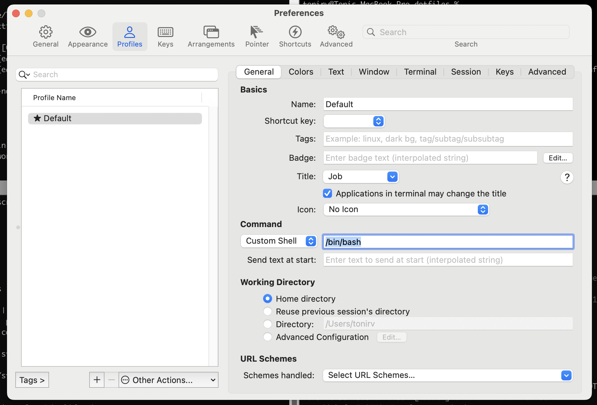

# My dotfiles

Bash, git, vim and readline configuration for **macOS and Linux** (Debian/Ubuntu), from a single branch.
The OS is detected at install time and at shell startup.

## Install

Clone the repo: ```git clone --recursive git@github.com:ToniRV/dotfiles.git```

Backup your previous dotfiles:
```
cp ~/.bashrc ~/.bashrc_backup
cp ~/.bash_profile ~/.bash_profile_backup
cp ~/.gitconfig ~/.gitconfig_backup
cp ~/.inputrc ~/.inputrc_backup
cp ~/.vimrc ~/.vimrc_backup
```

Find and replace the [user] fields with your details in the ```gitconfig``` file:
```
[user]
  email = youremail
  name = yourname
```
Otherwise, you will see me as the author of your commits :)

Install:
```./install```

This links the dotfiles (`install.conf.yaml`), then runs the OS specific part:
- **macOS** (`install.darwin.conf.yaml`): installs the [Homebrew](https://brew.sh) packages in `Brewfile`, Homebrew must be installed first.
- **Linux** (`install.linux.conf.yaml`): installs apt packages, links terminator and zathura configs, and loads GNOME keybindings.

Delete your backup files if you do not need them anymore.

### macOS terminal setup

-> iTerm2 users need to set both the Regular font and the Non-ASCII Font in "iTerm > Preferences > Profiles > Text" to use a patched (powerline) font.

-> iTerm2 users need to manually set the `Command` setting in `Profile` to `/opt/homebrew/bin/bash` (Homebrew's bash 5, see image below).
`/bin/bash` also works, but it is bash 3.2: no `globstar`/`autocd` and no bash-completion@2.



## Layout

```
bash_profile        entry point (~/.bashrc sources it for non-login shells)
bash.d/
  colors utils      loaded first
  os/darwin         macOS only: Homebrew, network helpers...
  os/linux          Linux only: clipboard (pbcopy/pbpaste), CUDA, MKL... (each only if installed)
  exports paths options prompt autocompletes aliases functions/*
  ros/ros           ROS 1 helpers, only loaded when /opt/ros exists
  bin/              scripts on PATH (cbuild, mp4-to-gif)
  local             your machine-specific settings, not tracked by git
gitignore           global gitignore, linked to ~/.config/git/ignore
config/             Linux app configs (terminator, zathura, GNOME keybindings)
utils/              standalone Linux scripts (ip_updater.sh, mute_and_lock.sh)
```

Put anything specific to one machine (work paths, tokens, extra aliases) in `~/.bash.d/local`.

## History

This branch used to be split into per-OS/per-ROS-distro branches (`master`, `osx`, `indigo`, `kinetic`, `melodic`, `noetic`).
They are all merged into this branch's history, and their last commits are tagged `archive/<branch>`.
